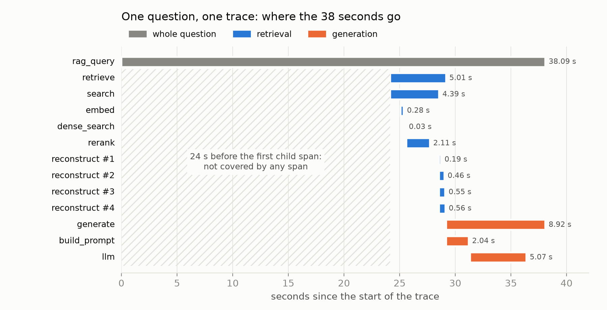
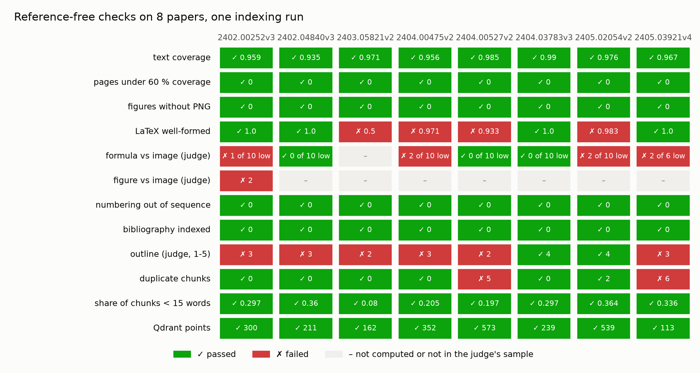
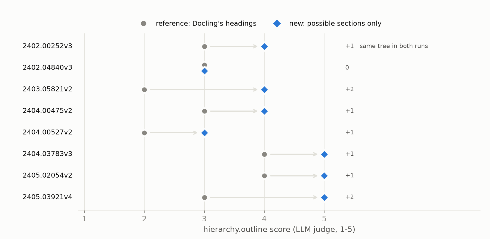

# Seeing inside a RAG: MLflow traces and checks that need no reference

Part 4 of a series on multimodal PDF pipelines.
[Part 1](https://medium.com/@oliver-mlops/the-first-step-of-a-multimodal-pipeline-which-pdf-parser-keeps-the-structure-303a9968e39f) compared PDF parsers. Part 2 toured the Streamlit app. Part 3 evaluated the chain on Open RAG Bench. This one is about what happens when there is no benchmark: tracing every step in MLflow, and attaching to each trace the checks that tell me whether it went well.

The code is on GitHub: (https://github.com/O-Faraday/hierarch_graph_rag).

At the end of Part 3 I wrote that a document failing a check should be visible before anyone asks it a question. This is how I did it, and the first thing it caught.

## 1. Two kinds of record

MLflow keeps two kinds of record, and I use both.

**Runs** hold numbers. Each pipeline execution is a parent run with one child run per step and per document: `parse:2403.05821v2.pdf`, `hierarchy:56f3f5b5c8f81e2e`, `index`. A child run logs the page count, the figures found, the time spent and the model used. It also stores the step's products as artifacts, such as the heading tree of the paper as plain text. Runs answer "how many" and "how long".

**Traces** hold content. A trace is a tree of spans, and each span keeps what its step received and what it produced:

- **One trace per document** at indexing time: `parse` (with `docling`, `export_figures`, and one `describe_figure` span per figure sent to the vision model), then `hierarchy`, then `index` (`chunk`, `embed_and_store`).
- **One trace per question**: `retrieve` (`embed`, `dense_search`, `rerank`, one `reconstruct` per section), then `generate` (`build_prompt`, `llm`).

Every trace carries the run key of its execution and the name of its PDF, so all the traces of one run can be found together.

*Figure 1: the spans of one question, "For optimizing queries in relational data, what does PHC mean and how to calculate its value?". Retrieval takes 5 seconds, generation 9.*

The first 24 seconds of Figure 1 are the first thing the trace showed me. The app opens the trace, then loads the embedding model and the reranker, and only then starts the first span. Streamlit caches both models, so only the first question of a session pays for them. A log line would have hidden this. In the trace, it is a hatched gap that no span covers.

*Figure 2 (screenshot): the same trace in the MLflow UI, with the `rerank` span open. 30 candidates go in, and the 5 best come out with two scores each. The chunk ranked first by the cross-encoder (0.887) had a vector similarity of only 0.376.*

## 2. Checks attached to the traces

A trace shows what happened. It does not say whether it was good. For that I attach **assessments** to the trace: one record per check, with a value, a pass or fail, a rationale, and the item it is about. In MLflow these records are called `Feedback`, and each one names its source:

- **Code** checks are deterministic and run on every document.
- **LLM judges** run on a sample, chosen by a hash of the item, so the same formula is always in or out of the sample.

On a document trace, the checks follow the steps:

| Step | Checks |
|---|---|
| Parse | words of the PDF text layer found by Docling, pages under 60 %, figures without a PNG, empty tables |
| Describe | LaTeX well-formed; a vision judge compares a formula or a figure with its crop |
| Hierarchy | numbering out of sequence, bibliography indexed by mistake; a text judge reads the outline |
| Chunks | duplicates, empty chunks, share of chunks under 15 words, one Qdrant point per chunk |

On a question trace, the checks follow the answer:

| Step | Checks |
|---|---|
| Retrieval | best reranker score; a judge rates each source and whether they are enough |
| Prompt | budget used, sections left out, figures sent as images |
| Answer | citations, numbers not found in the sources, refusal; a judge rates relevance and completeness |

For the PHC question of Figure 1, all eleven checks passed. The best reranker score was 0.887, 3 of 4 sources were judged relevant, the sources used 27 % of the character budget, and no number in the answer was missing from the sources.

*Figure 3 (screenshot): the Assessments panel of a document trace in the MLflow UI, with the rationale of the outline judge.*

## 3. What the grid showed

I indexed 8 arXiv papers with the judges turned on, and put every check in one grid.

*Figure 4: twelve checks on eight papers. Parsing is clean. The red cells are in the formulas and the outline.*

**Parsing was clean.** Docling found 93 to 99 % of the words of each paper, and no page fell under 60 %.

**Formulas had known faults.** Four papers have at least one LaTeX transcription cut off or looping, and the vision judge found 7 of 66 sampled transcriptions wrong.

**The outline judge failed 6 papers out of 8.** That was the surprise. Its rationales were specific: "an algorithm caption presented as a heading", "sections 4.1 and 4.2 confused", "author names as headings". Text filed under the wrong heading ends up in the wrong section. A hierarchical RAG rebuilds whole sections, so that is exactly the failure it cannot afford.

## 4. Following one red cell

The trace of a red cell holds the raw Docling headings, and the run holds the tree I built from them. Comparing the two told me where the fault was.

- **Docling** read things as headings that are not headings: author names, algorithm captions, "Proof of Lemma 3." and "Case 2 λ > 0.". It also gave wrong levels in two papers: 4.2 under 4.1, EC.3.1 at level 4.
- **My own code** added one fault. A rule that moved "References" up to the top level left the appendices behind, so they became children of References.

Rather than a filter for each anomaly, I wrote a definition of what a section can be. A heading can open a section only if it is:

- the title of the paper;
- a standard section name: Abstract, Introduction, Conclusion, References, Appendix…;
- or the next number in the paper's own numbering: after 2.2 come 2.3, 2.2.1 or 3.

Anything else becomes a paragraph of the section it is in. The levels now come from the numbers, not from Docling. A filter only catches the anomalies I have already seen. The definition also rejects the ones I have not.

## 5. Did it work? Read the judge carefully

I rebuilt the trees and the index (the parsing was cached) and ran the judge again.

*Figure 5: the outline score of each paper, before and after. The right column gives the change, and says where the tree did not change.*

The mean score went from **3.0 to 4.1**. But each run also stored its heading tree as an artifact, so I could compare the trees and not just the scores. **2402.00252v3 has exactly the same tree in both runs, and its score still went from 3 to 4.** The judge reads the same outline and does not always give the same score: on unchanged trees, one point either way is common. So I only count moves of two points or more: 2 → 4 on 2403.05821v2, 3 → 5 on 2405.03921v4. Those are real.

The judge is good at saying *what* is wrong and unreliable at saying *how much*. Its score tells me which paper to open. The artifact tells me whether anything changed.

The effect on the search itself is easier to count. **10 % of the elements changed section** compared with Docling's raw tree, and 43 % in the paper whose case labels had been read as headings. The chunks stayed the same. What changed is the section each chunk belongs to, so the section the language model reads.

One paper still scored 3 with a tree I thought perfect. The judge said a sub-section looked too big. I checked the PDF, and it was right: heading A.2.2 contains a formula, Docling had labelled it as a formula, and its content had joined A.2.1. A judge with a noisy score still found a real missing heading.

## 6. Limits, stated plainly

- Every check is mine, calibrated on a few dozen papers. A pass means "nothing I know how to detect", not "correct".
- The LLM judges are noisy: one point either way on the same input. I read their rationales, and I do not average their scores across a change.
- None of this measures the answers. Whether the better trees improve retrieval is a question for the benchmark of Part 3, and I have not run it yet.
- Traces cost disk space: about 300 KB per document, in a local SQLite store.

## 7. What comes next

- Run the benchmark again and see whether section hit and context recall follow the outline scores.
- Use the same tree for the heading prefix of each chunk at embedding time. Today the chunks still carry Docling's heading chain, so a chunk of section 4.2 is still embedded under "Algorithm 2".
- Let the numbering promote headings as well as reject them, for the A.2.2 that Docling labelled as a formula.

If you trace your own RAG pipeline, I would like to know which check caught your first real bug.
